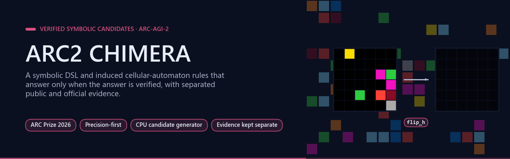
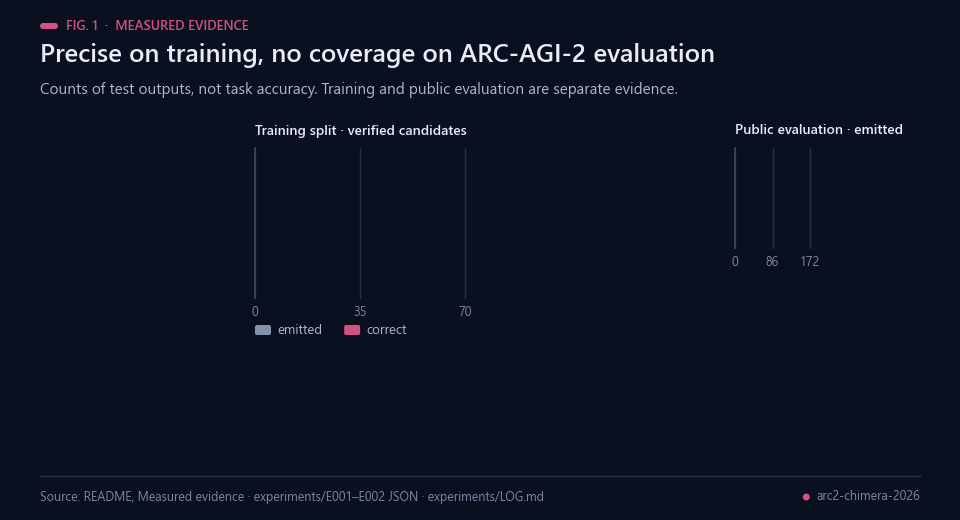
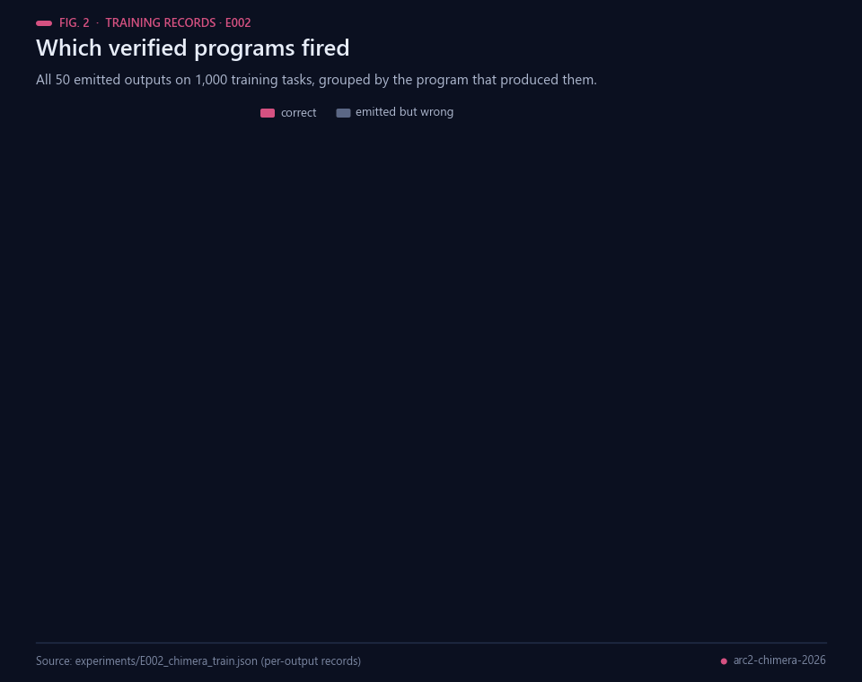
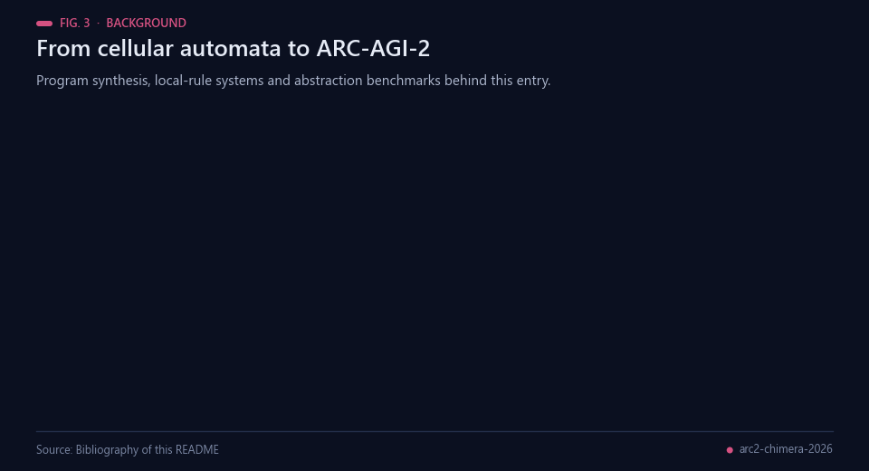
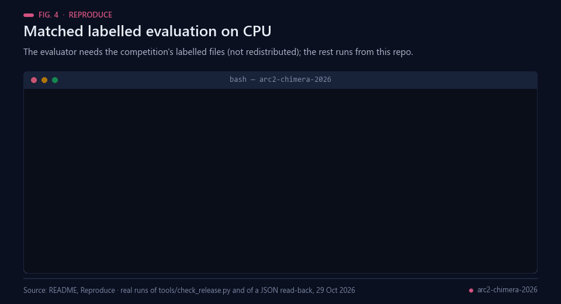
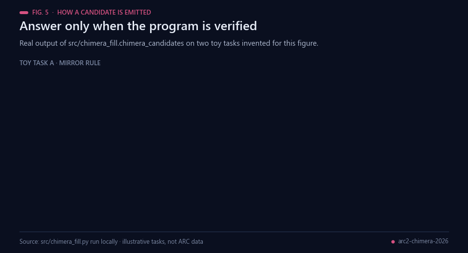
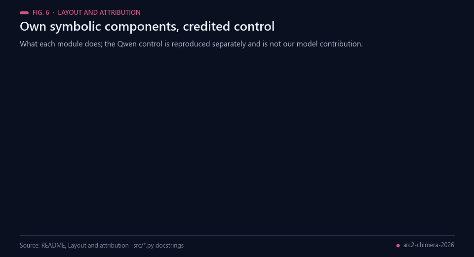
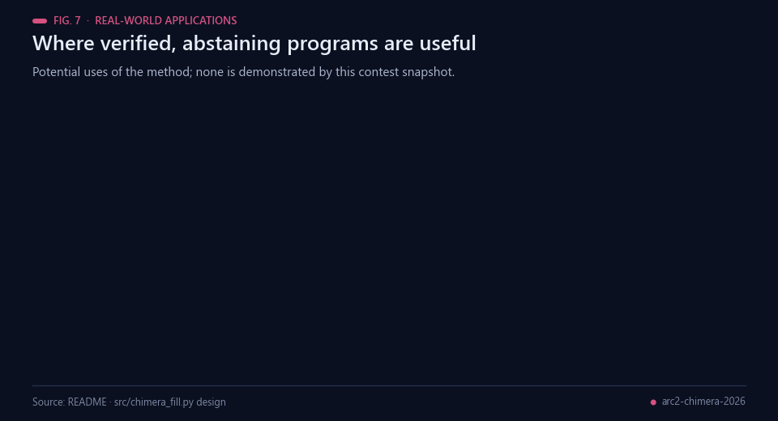
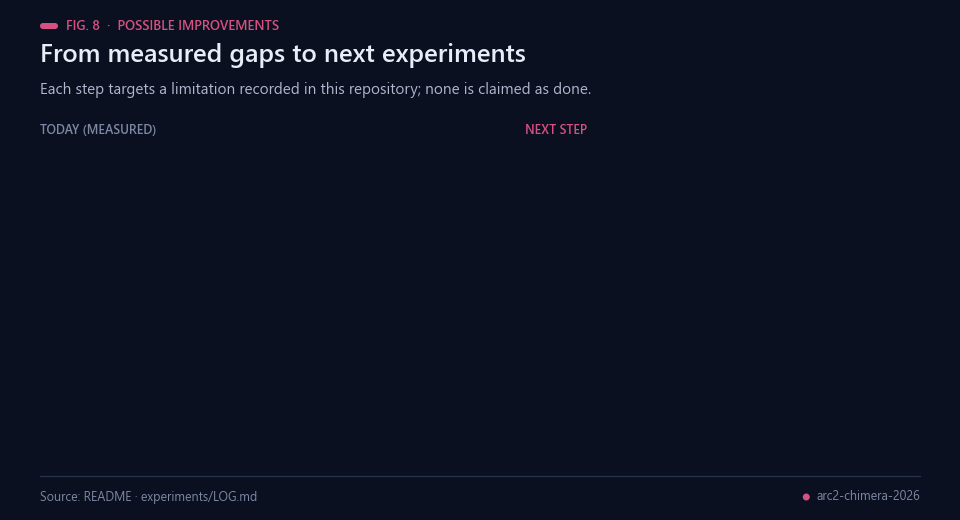
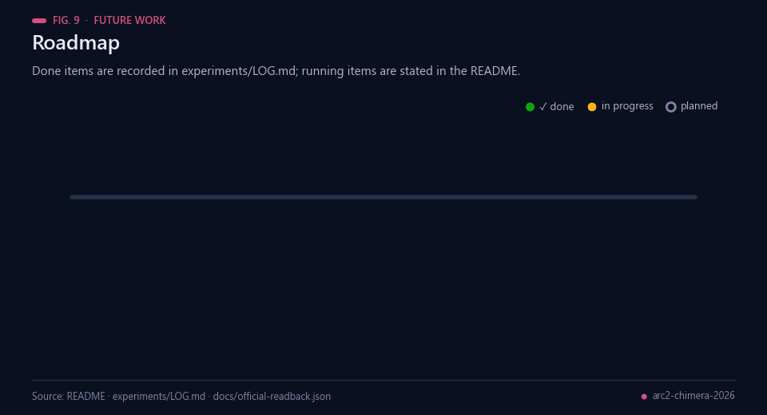

<div align="center">



# ARC2 CHIMERA — verified symbolic candidates for ARC-AGI-2

[](https://github.com/Agnuxo1/arc2-chimera-2026/actions/workflows/release.yml) [](LICENSE)  [](docs/RESEARCH_PROTOCOL.md) [](https://www.kaggle.com/competitions/arc-prize-2026-arc-agi-2)

[**Measured evidence**](#measured-evidence) · [**Reproduce**](#reproduce) · [**Experiment log**](experiments/LOG.md) · [**Research protocol**](docs/RESEARCH_PROTOCOL.md) · [**Official readback**](docs/official-readback.json) · [**Competition**](https://www.kaggle.com/competitions/arc-prize-2026-arc-agi-2)

</div>

Contest implementation derived from [ARC2_CHIMERA](https://github.com/Agnuxo1/ARC2_CHIMERA), combining a symbolic DSL, induced cellular-automaton rules and a separately credited Qwen control. [Official competition](https://www.kaggle.com/competitions/arc-prize-2026-arc-agi-2).

**Contents** — [Measured evidence](#measured-evidence) · [Background](#background) · [Reproduce](#reproduce) · [Layout and attribution](#layout-and-attribution) · [Real-world applications](#real-world-applications) · [Possible improvements](#possible-improvements) · [Future work](#future-work) · [Bibliography](#bibliography)

## Measured evidence

<p align="center"><br><sub>Fig. 1 — Training and public evaluation are separate evidence. Data: the table below and experiments/.</sub></p>

| Experiment | Outcome | Interpretation |
|---|---|---|
| E001, symbolic candidates on public evaluation | 0/172 outputs emitted | No demonstrated coverage on this split |
| E002, original candidates on training | 50 emitted, 44 correct; precision 0.88 | Positive candidate precision, limited coverage; training evidence |
| E003, expanded CA families | 59 emitted, 53 correct on training; CA v2 11/11, 9 additional outputs | Positive training contribution; still 0/172 evaluation coverage |
| E004, Kaggle control + CHIMERA commit | 3/172, same as control in its restricted commit mode | Successful integration, no measured gain on public commit tasks |

<p align="center"><br><sub>Fig. 2 — Every emitted output of E002, grouped by program. Data: experiments/E002_chimera_train.json.</sub></p>

These counts refer to outputs, not interchangeable task accuracy. The inherited control notebook restricts its ordinary commit evaluation to four tasks. Its 3/172 figure is not a full-budget hidden score. Official submission S01 is recorded as 57759538 in the project log; the 29October authenticated API readback still shows PENDING with no score. [Official readback](docs/official-readback.json). The 24-task fixed GPU control is still running on servidor-ia (job 32495d89b1c5419c). No additional compute is launched by this repository.

## Background

<p align="center"><br><sub>Fig. 3 — Ideas behind this entry. Sources: bibliography below.</sub></p>

The Abstraction and Reasoning Corpus (ARC) was proposed by Chollet as a test of skill-acquisition efficiency rather
than of memorised skill [[1](#ref-1)]: each task shows a few input–output grid pairs and asks for the output of a new
input. ARC-AGI-2 raises the difficulty with new tasks validated by human testers [[2](#ref-2)] and is the target of
the ARC Prize 2026 competition [[12](#ref-12), [13](#ref-13)]; the ARC Prize 2024 report describes how the strongest entries
combined program search with test-time training of neural models [[3](#ref-3), [4](#ref-4)]. Two older lines of work sit underneath this repository: programming by example, where a small
domain-specific language is searched for a program consistent with the demonstrations [[5](#ref-5), [6](#ref-6)], and cellular
automata, where one local rule applied to every cell produces global structure [[7](#ref-7), [8](#ref-8)].

CHIMERA is the author's earlier exploration of neural computation as OpenGL rendering operations [[11](#ref-11)], and
ARC2_CHIMERA its ARC proof-of-concept [[10](#ref-10)]. This contest implementation keeps two of its components as CPU
code: the symbolic DSL search (copied unchanged) and the CHIMERA v10 local-rule principle — each cell's next colour
is a function of its neighbourhood — induced from the demonstrations as a lookup table. Candidates from either source
are emitted only when they reproduce every training pair and pass a leave-one-out check. The control notebook
(a Qwen3-4B model fine-tuned on grids, with test-time training and depth-first search, per
[experiments/LOG.md](experiments/LOG.md)) builds on Qwen3 [[9](#ref-9)]; it is reproduced and credited separately
and is not the author's contribution.

## Reproduce

<p align="center"><br><sub>Fig. 4 — Commands from this section; outputs are real local runs.</sub></p>

Python 3.11+ and NumPy. Obtain the allowed labelled ARC files from the competition, outside the repository:

```bash
python -m pip install -r requirements.txt
python src/eval_chimera.py /path/challenges.json /path/solutions.json /path/result.json --workers 4
```

The evaluator writes coverage, precision, per-output records and exceptions. It evaluates the original candidate generator; CA v2 is a separately exposed module, not silently substituted into that command. See [experiment log](experiments/LOG.md) and [research protocol](docs/RESEARCH_PROTOCOL.md). Data, weights and the third-party LLM notebook are not redistributed here. The separately reproduced Qwen control is not our model contribution.

## Layout and attribution

<p align="center"><br><sub>Fig. 5 — The real candidate gate (<code>src/chimera_fill.py</code>) on two toy tasks invented for the figure.</sub></p>

<p align="center"><br><sub>Fig. 6 — What each module does, and what is credited to others.</sub></p>

`src/chimera_dsl.py`: own prior symbolic solver; `chimera_fill.py`: verified candidate gate; `chimera_ca2.py`: expanded rules; `eval_chimera.py`: matched labelled evaluation. Upstream ARC2_CHIMERA licence is retained. The Qwen/control component needs its own model and notebook licences and competition packaging before deployment. Repository publication does not establish acceptance, rank or prize.

## Real-world applications

<p align="center"><br><sub>Fig. 7 — Potential uses of verified, abstaining program search; none is demonstrated by this snapshot.</sub></p>

- **Programming by example.** Infer grid or table transformations from a few demonstrations and emit a program only
  when it reproduces all of them — the setting popularised by spreadsheet synthesis [[5](#ref-5)].
- **Precision-first components.** A generator that abstains can sit beside a neural model and answer only the cases
  it can verify on the examples; on training it was right on 44 of 50 emitted outputs (E002).
- **Image and layout rules.** Local rules induced from pairs, in the cellular-automaton sense [[7](#ref-7)], could
  describe repeated pixel-level edits in diagrams, maps and sprites.
- **Benchmark auditing.** Per-output records separate coverage from precision, and training, public and official
  evidence are kept apart.
- **Teaching reasoning.** Readable DSL programs (`flip_h`, `gravity_down`, `center_object`) explain why an answer is
  right.
- **CPU-only pipelines.** Candidate generation took 49.5 s of CPU for 1,000 training tasks (E002).

## Possible improvements

<p align="center"><br><sub>Fig. 8 — Each improvement answers a limitation recorded in this repository.</sub></p>

- **Coverage on ARC-AGI-2.** The symbolic and CA candidates emitted nothing on the 172 public evaluation outputs
  (E001, E003). New rule families should be chosen on training only and checked in one frozen evaluation pass.
- **Wire in CA v2.** The expanded rules are a separate module, not substituted into the evaluator command; adding
  them behind a flag allows a matched re-run.
- **A full-budget control comparison.** The inherited control evaluates four tasks in its commit mode, so 3/172 is
  not a full-budget score; control and control + CHIMERA should be compared on fixed tasks at full budget.
- **Official evidence.** The S01 readback is still pending; when a score appears it must stay separate from local
  evidence, as the research protocol requires.

## Future work

<p align="center"><br><sub>Fig. 9 — Done items are in experiments/LOG.md; the running GPU control is stated in this README.</sub></p>

1. Finish the 24-task fixed GPU control that is running on servidor-ia.
2. Record the official S01 score when the readback leaves PENDING.
3. Add CA v2 to the evaluator behind a flag and repeat the matched labelled evaluation.
4. Search new rule families on training only, then run one frozen evaluation pass.
5. Compare control and control + CHIMERA at full budget on fixed tasks.

## Bibliography

1. <a id="ref-1"></a>Chollet, F. (2019). On the Measure of Intelligence. *arXiv* 1911.01547. https://arxiv.org/abs/1911.01547
2. <a id="ref-2"></a>Chollet, F., Knoop, M., Kamradt, G., Landers, B., & Pinkard, H. (2025). ARC-AGI-2: A New Challenge for Frontier AI Reasoning Systems. *arXiv* 2505.11831. https://arxiv.org/abs/2505.11831
3. <a id="ref-3"></a>Chollet, F., Knoop, M., Kamradt, G., & Landers, B. (2024). ARC Prize 2024: Technical Report. *arXiv* 2412.04604. https://arxiv.org/abs/2412.04604
4. <a id="ref-4"></a>Akyürek, E., Damani, M., Zweiger, A., et al. (2024). The Surprising Effectiveness of Test-Time Training for Few-Shot Learning. *arXiv* 2411.07279. https://arxiv.org/abs/2411.07279
5. <a id="ref-5"></a>Gulwani, S. (2011). Automating string processing in spreadsheets using input-output examples. *Proceedings of the 38th annual ACM SIGPLAN-SIGACT symposium on Principles of programming languages*, 317–330. https://doi.org/10.1145/1926385.1926423
6. <a id="ref-6"></a>Ellis, K., Wong, C., Nye, M., et al. (2021). DreamCoder: bootstrapping inductive program synthesis with wake-sleep library learning. *Proceedings of the 42nd ACM SIGPLAN International Conference on Programming Language Design and Implementation*, 835–850. https://doi.org/10.1145/3453483.3454080
7. <a id="ref-7"></a>Wolfram, S. (1983). Statistical mechanics of cellular automata. *Reviews of Modern Physics*, 55(3), 601–644. https://doi.org/10.1103/RevModPhys.55.601
8. <a id="ref-8"></a>Mordvintsev, A., Randazzo, E., Niklasson, E., & Levin, M. (2020). Growing Neural Cellular Automata. *Distill*, 5(2). https://doi.org/10.23915/distill.00023
9. <a id="ref-9"></a>Yang, A., Li, A., Yang, B., et al. (2025). Qwen3 Technical Report. *arXiv* 2505.09388. https://arxiv.org/abs/2505.09388
10. <a id="ref-10"></a>Angulo de Lafuente, F. *ARC2_CHIMERA: research proof-of-concept for ARC-AGI* (software). https://github.com/Agnuxo1/ARC2_CHIMERA
11. <a id="ref-11"></a>Angulo de Lafuente, F. *CHIMERA: deep learning on OpenGL* (software). https://github.com/Agnuxo1/CHIMERA-Revolutionary-AI-Architecture---Pure-OpenGL-Deep-Learning
12. <a id="ref-12"></a>ARC Prize Foundation & Kaggle (2026). *ARC Prize 2026: ARC-AGI-2* (competition). https://www.kaggle.com/competitions/arc-prize-2026-arc-agi-2
13. <a id="ref-13"></a>ARC Prize Foundation. *ARC Prize* (website). https://arcprize.org/

---

<div align="center">
<sub>Built by <a href="https://github.com/Agnuxo1">Francisco Angulo de Lafuente</a> · every figure is an animated
rendering of the published file or the real code run named in its footer ·
<a href="#arc2-chimera--verified-symbolic-candidates-for-arc-agi-2">back to top ↑</a></sub>
</div>
